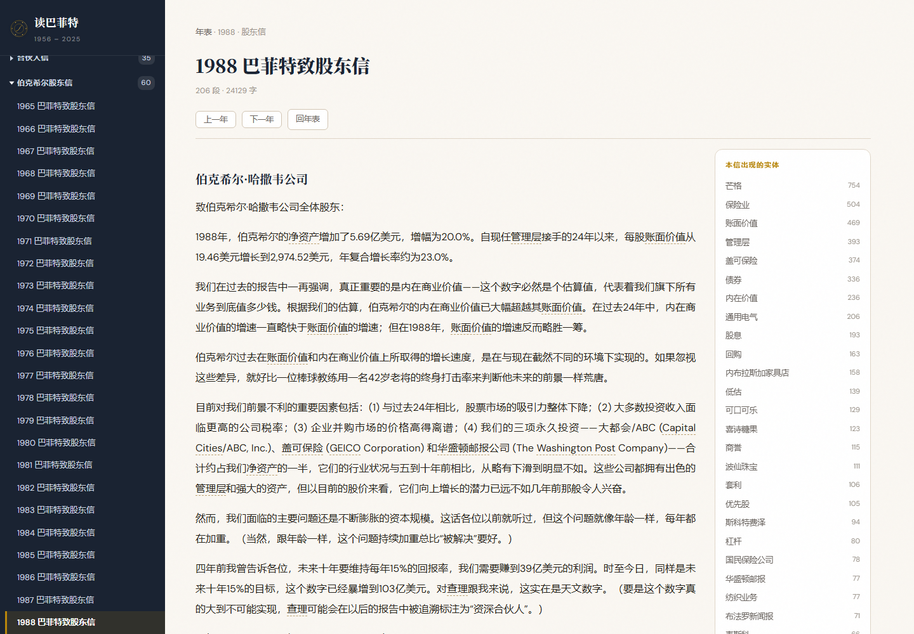
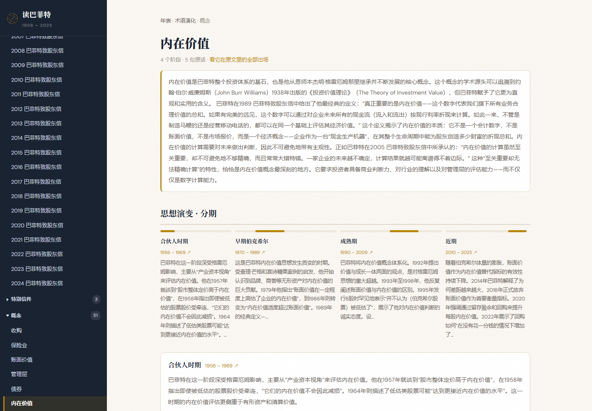
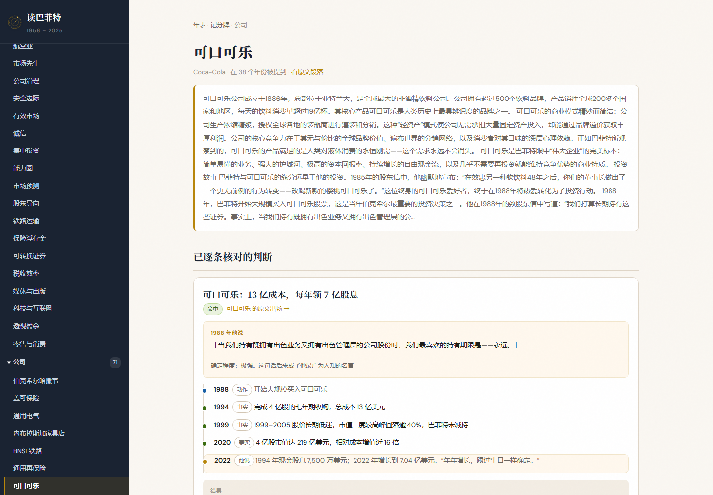
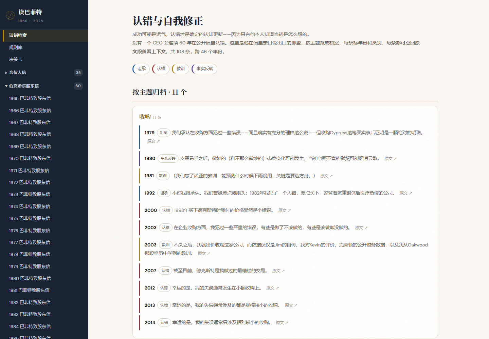
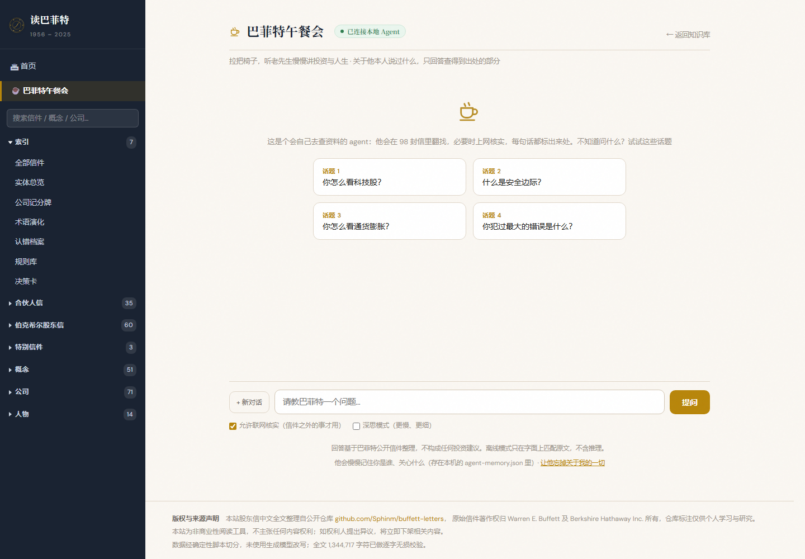
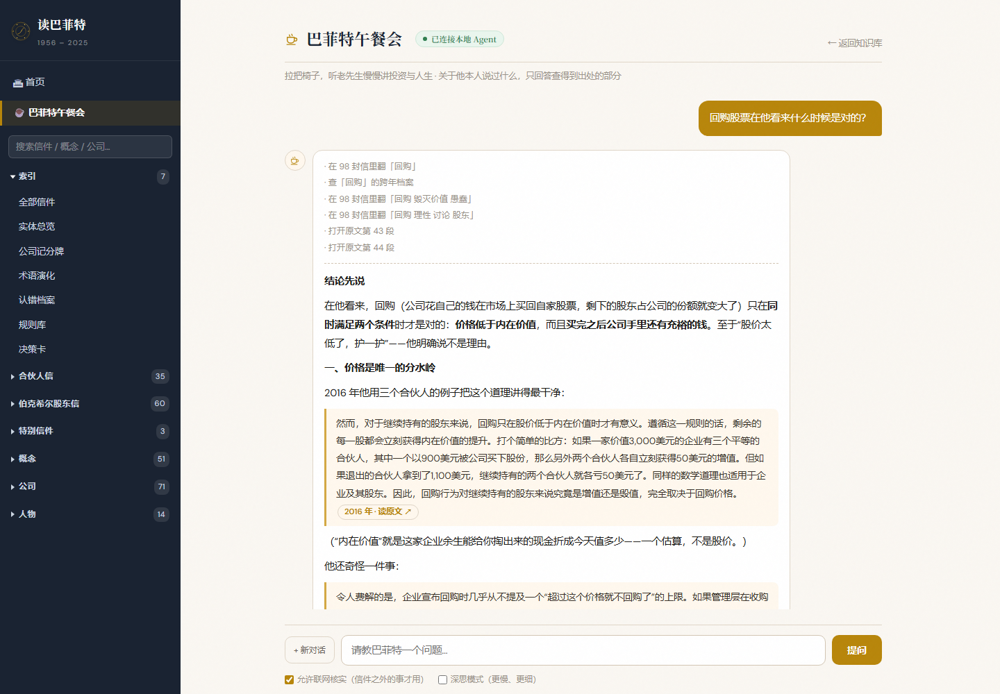
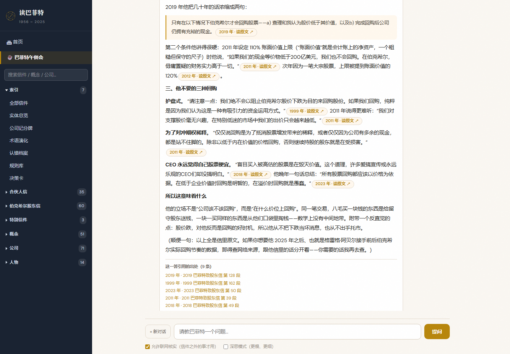

# 读巴菲特 · 98 封信的中文知识库与问答 Agent

> 把巴菲特 1956–2025 年的致股东信做成能读、能查、能追问的中文知识库，
> 配一个会自己去翻原文、会联网核实、**每句话都标出出处**的问答 Agent。


---

## 它是什么

一个纯前端的静态站点（零框架、零构建、零第三方依赖），加一个可选的本机 Agent 服务。

| | |
|---|---|
| 📖 **98 封信** | 1956–2025，全文 1,344,717 字，逐字无损，段落级可跳转 |
| 🧭 **51 个概念 · 71 家公司 · 14 位人物** | 跨年档案：同一个话题他在不同年份说过什么，一条时间线串起来 |
| 🤖 **巴菲特午餐会** | 真正的 Agent：自己决定查什么、查几次，翻完原文再回答，必要时联网 |
| 🔗 **435 个地址全部可达** | 全站零死链（审计口径见下） |

**最不一样的一点**：这里的每一句"他说过什么"，都能点回原信的某一年某一段。Agent 不会编造他没说过的话——查不到就直说查不到。


---

## 看看它能做什么

### 1. 读原文

信件阅读页：段落编号、本信出现的实体、可跳转的目录。



### 2. 概念跨年档案

一个概念（比如"内在价值"）在 70 年里被怎么反复讲，按年份分期铺开。



### 3. 公司轨迹

可口可乐从 1988 年买入到最近一次被提起，逐年记录。



### 4. 认错档案

108 条他公开承认过的错误与教训，按年份和严重程度整理——这部分比成功经验更有信息量。



### 5. 巴菲特午餐会（Agent）



问一句「回购股票在他看来什么时候是对的？」，它的实际行为：



> 上方是它自己决定翻的东西：在 98 封信里翻「回购」→ 查「回购」的概念档案 → 换关键词再翻两次 → 打开原文第 43、44 段确认上下文。



答案里：

- **橙色胶囊**是出处，点进去直接跳到那一封信的那一段
- 底部摊开**出处清单**，以及这轮的**成本**：查了几次资料、跑了几轮、用了多少 tokens
- 回答右上角会显示连接状态；服务没起时会明确写「离线模式」，不假装有 AI

---

## Agent 是怎么设计的

详见 [docs/AGENT.md](docs/AGENT.md)。核心是四点：

**① 它自己决定查什么，而不是被投喂一次检索结果。**
每轮最多 6 次工具调用循环。第一轮证据不够就换关键词再查，或改查概念档案、公司轨迹、认错档案。实测「回购股票什么时候是对的」这一问，它自己调了 9 次工具、跑了 4 轮。

**② 九件工具。**

| 工具 | 作用 |
|---|---|
| `search_letters` | 在 98 封信的 8,679 个段落里检索 |
| `open_passage` | 打开某一封信的某一段，看完整上下文 |
| `letter_outline` | 某一年那封信讲了什么 |
| `concept_profile` | 概念的跨年档案 |
| `company_timeline` | 公司的跨年轨迹 |
| `corrections` | 认错档案 |
| `web_search` | 联网搜索（问信件年份之外的事时才用） |
| `open_url` | 打开某个网页读正文 |
| `remember` | 写入长期记忆 |

**③ 三层记忆。**
会话内上下文（多轮追问接得住）、本轮已引用段落（来源不重复列）、跨会话长期笔记（`agent-memory.json`，下次进 system prompt）。页面上有「让他忘掉关于我的一切」。

**④ 行为底线写进提示词。**
关于他说过什么，只能来自工具返回的原文；查不到就直说；联网结果必须和信里原话区分标注。

**关于向量数据库**：没用。8,679 段、119 万字的规模下，中文 n-gram + tf-idf 字面检索单问 68–281 ms，比一次网络请求还短。真正的同义召回靠人工整理的 49 个概念档案 + 别名表覆盖（问"护城河"会落到他说的"竞争优势"）。省掉了 embedding 的构建、存储和首屏体积代价。将来接更强的模型也只需把这里的 top-k 当上下文。

---

## 快速开始

### 只读知识库（不需要任何配置）

直接用浏览器打开 `site/index.html`。全部 435 个页面都能用，只是问答会落到「离线模式（关键词检索）」。

### 完整 Agent（推荐）

```bash
# 1. 把 DeepSeek 密钥写进本机文件（只在本地，绝不进网页）
echo "sk-你的密钥" > _agent.key

# 2. 双击 start.bat（Windows），或：
node agent.js

# 3. 打开 http://127.0.0.1:8099/index.html#/talk
```

命令行直连试跑（调试 Agent 行为时比在浏览器里看方便）：

```bash
node _agentcli.js "回购股票在他看来什么时候是对的？"
```

> ⚠️ **密钥安全**：`_agent.key` 只在服务端被读取，前端拿不到。它在 `.gitignore` 里，不会进仓库。
> 如果你把密钥贴给过别人或在聊天里明文出现过，去 DeepSeek 后台轮换一次。

---

## 项目结构

```
├── site/                 纯前端站点，打开 index.html 就能用
│   ├── index.html        全部页面、样式与交互（单文件，约 147 KB）
│   ├── data-core.js      信件元数据 + 实体归属表 + 别名表
│   ├── data-content.js   概念档案 / 公司轨迹 / 108 条认错记录
│   └── data-letters.js   信件全文（3.7 MB）
├── agent.js              本机 Agent 服务：静态托管 + SSE + 工具循环 + 记忆（零依赖）
├── start.bat             双击启动，自动找 node 并开浏览器
├── _agentcli.js          命令行直连试跑
├── build.py              从语料源生成 site/data-*.js
├── _src/buffett-letters  语料源（第三方仓库的克隆，不进本仓库）
├── docs/                 项目文档与截图
└── linkaudit.js 等       验收脚本（见下）
```

数据来源：[Sphinm/buffett-letters](https://github.com/Sphinm/buffett-letters)（commit `c1af0be`），
原始出处的中文结构化知识库，经 `build.py` 生成本站数据。信件原文为巴菲特公开披露文件。

---

## 质量怎么保证

页面上的数字都是运行时实算的，不是写死的标语。审计数字来自脚本实测：

| 项 | 结果 |
|---|---|
| 路由 446 条 | 异常 0 |
| 去重链接 1,255 条 | 落地失败 0 |
| 链接命中测试 4,743 处 | 遮挡 0 |
| 真实鼠标点击 1,276 次 | 失败 0 |

脚本：

```bash
node linkaudit.js --file --w=1440   # 路由 / 落地 / 命中 / 真实点击（1440 与 390 各一遍）
node actaudit.js  --file            # 无 href 的可点元素
node talktest.js  --file            # 对话页端到端（在线测 Agent 全流程，离线测降级）
node smoke.js     --file            # 内容断言
```

其中「真实鼠标点击」是用 CDP 发真的鼠标事件点的，不是判定 `href` 是否存在——
有一轮审计就是靠它抓出一个真问题：`?q=` 自动提问的定时器没判断当前是否还在对话页，
会在几十毫秒后把用户正看着的页面整个重绘掉。

---

## 路线图

- [ ] 英文原文对照（已确认第一版不做）
- [ ] Agent 的多轮工具调用成本可视化（已显示轮次与 tokens，待加单条明细）
- [ ] 支持接入其他模型（当前 DeepSeek `deepseek-v4-pro` / `deepseek-flash`）
- [ ] 公网部署版本的额度控制

---

## 许可与免责

代码：**MIT**。信件原文为巴菲特公开披露文件，本站只做整理与中文呈现，版权归原作者。

**本站内容仅供学习，不构成任何投资建议。**

---

<sub>最近一次全量审计：2026-10-30 · 截图由 `_docshots.js` 生成</sub>
