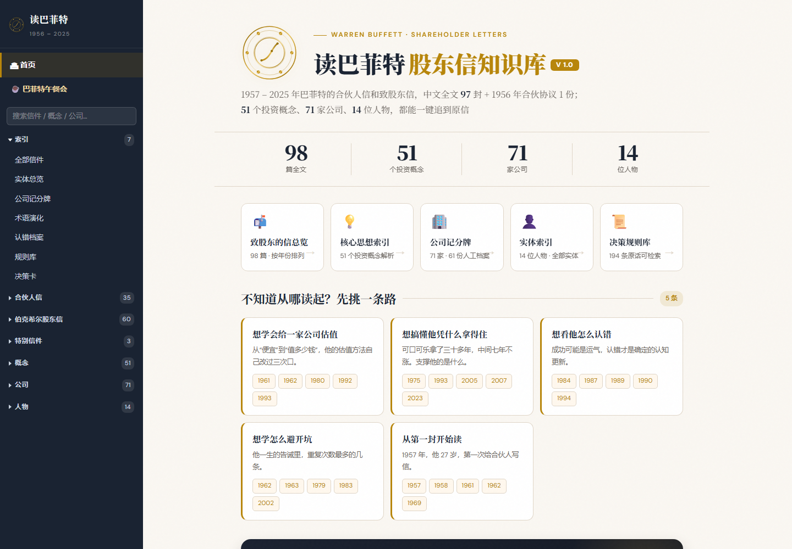
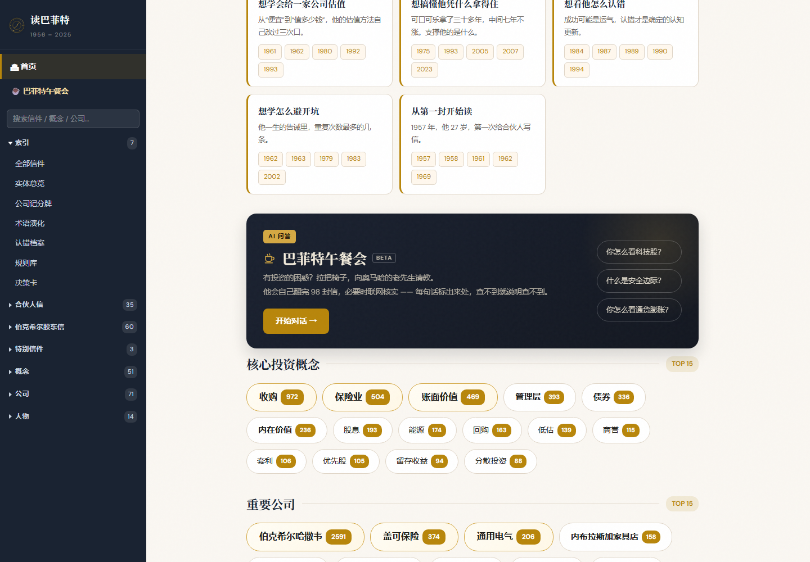
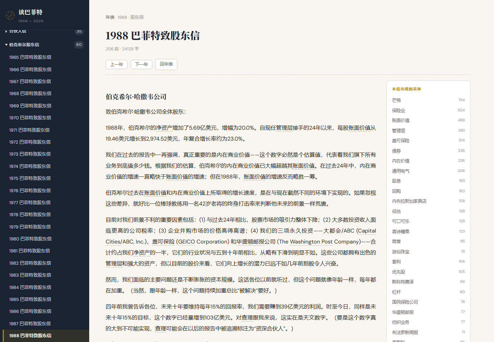
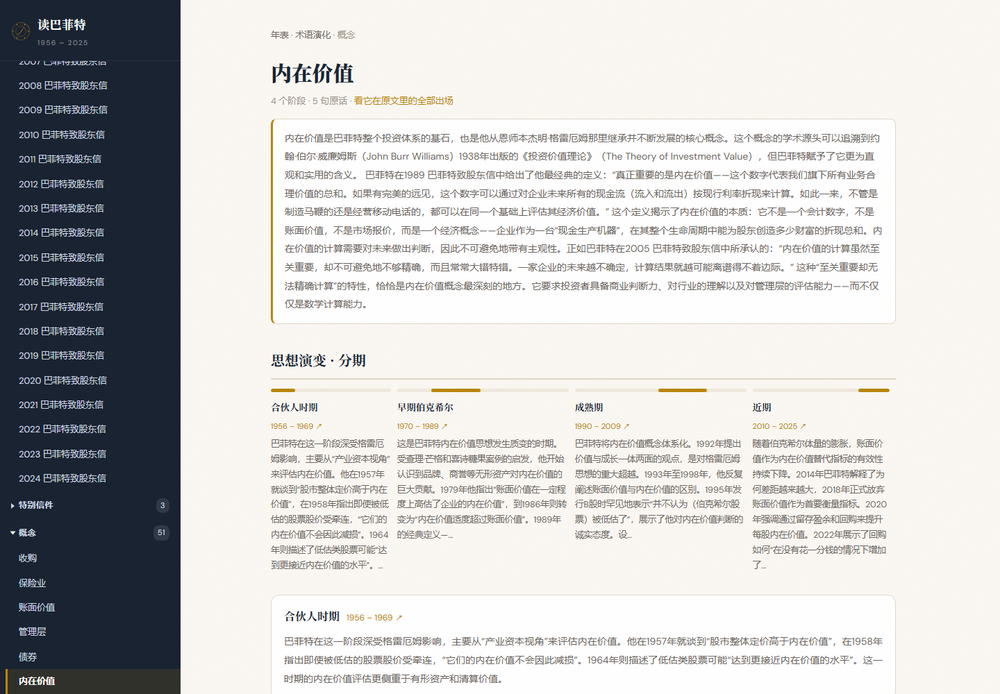
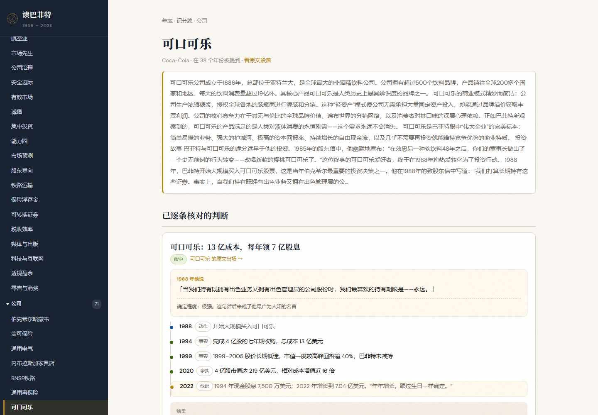
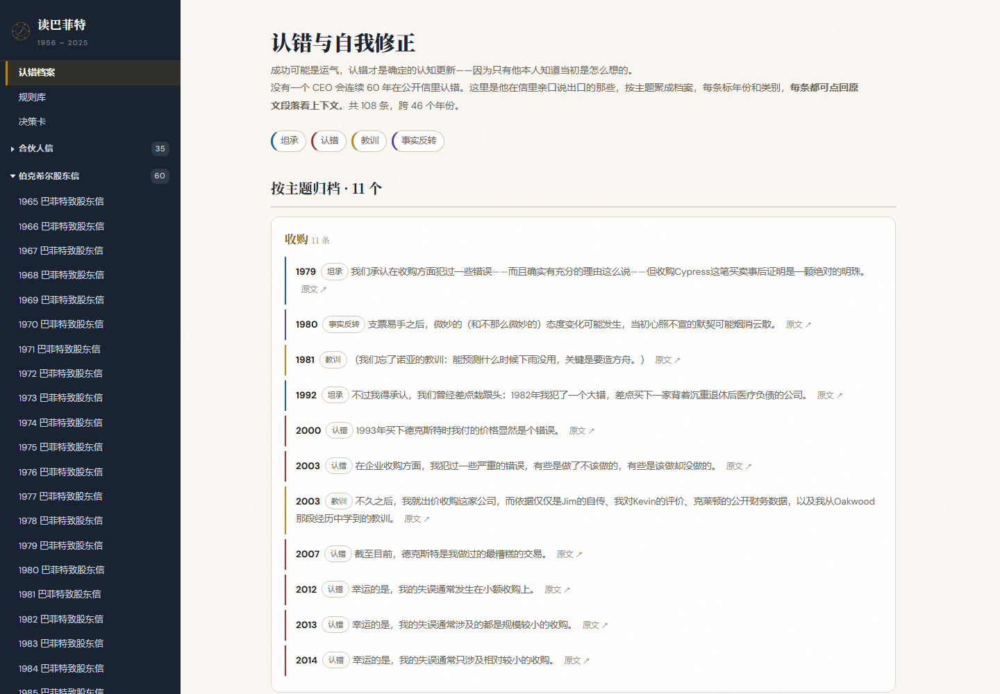
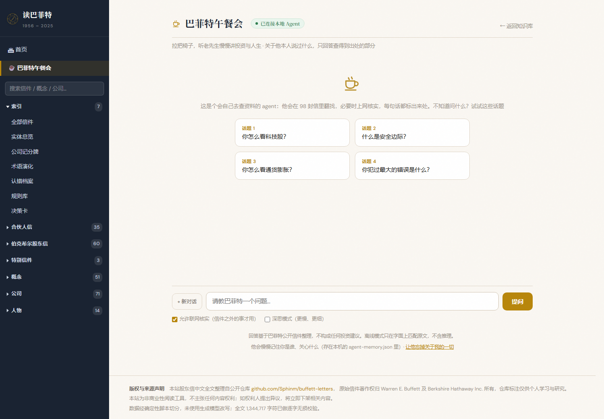
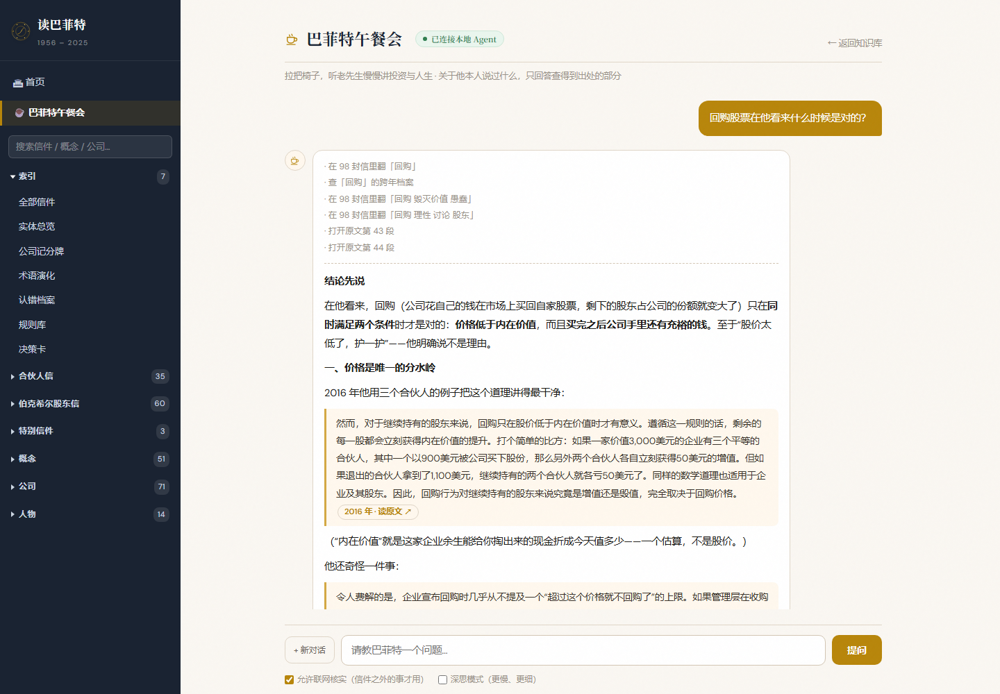
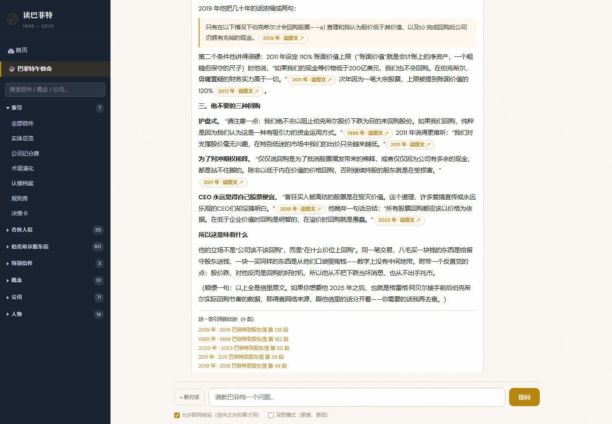

# 读巴菲特 · 98 封信的中文知识库与问答 Agent

> 把巴菲特 1956–2025 年的致股东信做成能读、能查、能追问的中文知识库，
> 配一个会自己去翻原文、会联网核实、**每句话都标出出处**的问答 Agent。

**在线体验**：https://buffett-letters-zh.app.workbuddy.host/?sharecode=CXAZT22VF2
（线上实例每位访客免费问答 10 次，用完可填自己的 DeepSeek 密钥继续；只读知识库部分无需任何配置）



---

## 它是什么

一个纯前端的静态站点（零框架、零构建、零第三方依赖），加一个可选的本机 Agent 服务。

| | |
|---|---|
| 📖 **98 封信** | 1956–2025，全文 1,344,717 字，逐字无损，段落级可跳转 |
| 🧭 **51 个概念 · 71 家公司 · 14 位人物** | 跨年档案：同一个话题他在不同年份说过什么，一条时间线串起来 |
| 🤖 **巴菲特午餐会** | 真正的 Agent：自己决定查什么、查几次，翻完原文再回答，必要时联网 |
| 🔗 **435 个地址全部可达** | 全站零死链（审计口径见下） |

**最不一样的一点**：这里的每一句"他说过什么"，都能点回原信的某一年某一段。Agent 不会编造他没说过的话——查不到就直说查不到。



---

## 看看它能做什么

### 1. 读原文

信件阅读页：段落编号、本信出现的实体、可跳转的目录。



### 2. 概念跨年档案

一个概念（比如"内在价值"）在 70 年里被怎么反复讲，按年份分期铺开。



### 3. 公司轨迹

可口可乐从 1988 年买入到最近一次被提起，逐年记录。



### 4. 认错档案

108 条他公开承认过的错误与教训，按年份和严重程度整理——这部分比成功经验更有信息量。



### 5. 巴菲特午餐会（Agent）



问一句「回购股票在他看来什么时候是对的？」，它的实际行为：



> 上方是它自己决定翻的东西：在 98 封信里翻「回购」→ 查「回购」的概念档案 → 换关键词再翻两次 → 打开原文第 43、44 段确认上下文。



答案里：

- **橙色胶囊**是出处，点进去直接跳到那一封信的那一段
- 底部摊开**出处清单**，以及这轮的**成本**：查了几次资料、跑了几轮、用了多少 tokens
- 回答右上角会显示连接状态；服务没起时会明确写「离线模式」，不假装有 AI

---

## Agent 是怎么设计的

详见 [docs/AGENT.md](docs/AGENT.md)。核心是四点：

**① 它自己决定查什么，而不是被投喂一次检索结果。**
每轮最多 6 次工具调用循环。第一轮证据不够就换关键词再查，或改查概念档案、公司轨迹、认错档案。实测「回购股票什么时候是对的」这一问，它自己调了 9 次工具、跑了 4 轮。

**② 十八种工具**（考据模式用前十二种，分身模式另加最后六种）。

| 工具 | 作用 |
|---|---|
| `search_letters` | 在 98 封信的 8,679 个段落里检索 |
| `open_passage` | 打开某一封信的某一段，看完整上下文 |
| `letter_outline` | 某一年那封信讲了什么 |
| `concept_profile` | 概念的跨年档案 |
| `company_timeline` | 公司的跨年轨迹 |
| `corrections` | 认错档案 |
| `stance_timeline` | 一个话题在各年的说法，按时间排开 |
| `count_mentions` | 某个词在信里出现过多少次、跨哪些年 |
| `talk_search` | 股东大会问答（380 条精选字幕中译） |
| `speech_search` | 1985–2025 的公开演讲与访谈 |
| `web_search` | 联网搜索（问信件年份之外的事时才用） |
| `open_url` | 打开某个网页读正文 |
| `remember` | 写入长期记忆 |
| `match_situation` | 把今天发生的一件事，对到历史上结构相近的旧判断（分身用） |
| `case_detail` | 打开某条旧案例：当时情形 / 他当时的判断 / 后来结果（分身用） |
| `market_snapshot` | A 股行情 + 四期财报 + 五年价格分位 + 最近公告（分身用） |
| `peer_compare` | 一次比 2–5 家同行的估值与增长（分身用） |
| `market_news` | 最近的财经资讯与公司公告（分身用） |

**③ 三层记忆。**
会话内上下文（多轮追问接得住）、本轮已引用段落（来源不重复列）、跨会话长期笔记（`agent-memory.json`，下次进 system prompt）。页面上有「让他忘掉关于我的一切」。

**④ 行为底线写进提示词。**
关于他说过什么，只能来自工具返回的原文；查不到就直说；联网结果必须和信里原话区分标注。

**关于向量数据库**：没用，四路语料（29,489 段 / 314 万字）全部线性扫描，单次检索 **0.6–27 ms，热缓存 8.8 ms**（`node _bench_search.js` 可复算）。同一规模下向量库暴力算余弦也要 5–10 ms，ANN 索引省不出时间，却要多付一次 query 编码——本地小模型 10–30 ms，调 API 100–300 ms，端到端反而更慢。

真正拦住的不止速度，还有两件更要紧的：

- **回测要按年份截断**：1998 年那道题不许用 2019 年的话。字面检索加一个 `y > yr` 就过滤掉了；向量相似度排序会混进不该出现的段落，回测就废了。
- **引用要落到「1999 年上午场第 3 段」**，读者能点开核对。余弦相似度 0.83 解释不了这个结论是怎么来的。

同义召回靠 49 个概念档案 + 别名表覆盖（问"护城河"会落到他说的"竞争优势"），再靠模型自己改写查询——trace 里 173 次 `talk_search` 的查询全是「商誉 减值」「商誉 摊销 经济商誉」这种关键词式，不是大白话，因为模型知道自己在搜原文语料。

**2026-11-03 补记**：实测发现真正的漏召回不在措辞，而在索引——股东大会那 5.5 万段股东提问被 `who === 'buffett'` 过滤掉了，`ask` 字段恒为空。补进去之后配对率 80%（20,119/25,104），「商誉」的 Top-1 从「有趣的是你区分了爱尔兰的更多阳光」变成「你对商誉会计新标准的评论？」。同一天还发现同一场回答被切成多段、口语寒暄单独成段会抢排位，把 60 字以下的连续段并起来，段数 25,104 → 18,400，检索从 26.9 ms 降到 8.8 ms。

---

## 巴菲特虚拟化身：拿今天的事问他

读完这些信，我们已知他面对各种情形时是怎么判断的。于是可以拿**今天 A 股发生的一件事**去问他「你会怎么想」。

**这与考据模式是两条并列的路，不是同一件事换句话**：

| | 考据模式 | 分身模式 |
|---|---|---|
| 问的是 | 他当年说过什么 | 他面对今天这件事会怎么想 |
| 答案里的话 | 逐字来自原信，可点回某一段 | 分五段：原话 + 现在的事实 + 我怎么量它 + 所以 + 我可能错在哪 |
| 查不到时 | 直说没查到 | 【他确实说过】留空，其余四段照旧但标清依据 |
| 判分 | 逐字忠实率 ≥ 95% | 五段齐全、引文可核、立场明确、证伪点可观察（`eval/check_sim.js`） |

**五段结构是这套设计的关键**：铁律从「不许补句子」升级成「不许把推演冒充原话」。
只有【他确实说过】允许出现引号，其余四段一律不许用引号引他的话；页面把原话区单独框起来，
并常驻标注「模拟推演，非本人观点，不构成投资建议」。

**案例库怎么来的**：`extract_cases.js` 从现有档案生成 `site/data-cases.js`，共 415 条
（77 张记分卡 + 227 条判断原则 + 111 条认错），299 条能点回原信、326 条经段落文本核对确认逐字可引。
其中有一批是「没买的那半边」（科技股 1999、亚马逊债、沃尔玛、房地美、黄金）——
只有买过的案例，分身会把「他什么都买过」当成结论。
检索沿用项目约定：n-gram + tf-idf 粗召回，再用情形格子命中数重排，不上向量库。

**已知短板**：字面检索分不清方向，市场亢奋时仍会召回「便宜时买」的原则。已加冷/热标记把这类标成 `[反向对照]` 并降权，但必须靠提示词兜底，不能算「换个方向再问」这一项及格。

### 两类问题，两条路

读者的问题其实只有两种，混在一起答就会两头不靠：**问过去**（他当年怎么说）和**问今天**（这件事现在该怎么看）。

| | 考据 | 研判 |
|---|---|---|
| 典型问法 | 「他对回购的态度变了吗」 | 「茅台这个价位你会买吗」 |
| 答案骨架 | 一句结论 + 逐字原文 + 所以这意味着什么 | 五段：他确实说过 / 现在的事实 / 我怎么量它 / 所以 / 我可能错在哪 |
| 数据来源 | 98 封信 + 股东大会 + 演讲 | 上面这些 + 实时行情/财报/资讯/联网搜索 |
| 判分 | 逐字忠实率、引用存在率、句级落地率 | 五段齐全、立场明确、有证伪点、数字与行情对得上 |

**分诊在服务端做**（`triageMode`）。前端两个 tab 只是偏好，进服务端后按问题内容改道：句子里有「他说过/信里/哪一年」且没有时间词 → 考据；有「现在/最近/今年」、有「你怎么看」、或带决策词（该不该、值不值、还能追、是不是比…划算）→ 研判。判不准时偏向考据，因为考据不会编数字。

为什么非要在服务端改道：读者不会先想清楚自己问的是哪一类。实测「银行股股息率这么高，是不是比存银行划算」这句话里没有时间词，最初被判成考据题，答案退回了叙述体，五段和立场全丢。加上「比较型决策」这一类判据后，同一句话改走研判，五段齐全、落到「不买」。

**研判的硬约束**（写死在提示词里，改的时候别削掉）：

1. 【现在的事实】每条必须带日期或报告期和数字，不许写「业绩承压」「估值处于低位」这种把结论当事实的句子。
2. 【我怎么量它】每个角度必须有「尺子 + 读数 + 判断」三件套；尺子三种标法任选——
   标 〔案例id〕、标 [[信|段]]、或写清「哪一年、什么场合」（股东大会/演讲的语料没有信件标记，
   绝不许给它们编一个），但必须是工具真返回过的。
3. 【所以】四选一：买 / 不买 / 等 / 看不懂。拿两样东西硬比的问法也要落一个结论，不许用「我给不了你结论」收尾。
4. 【我可能错在哪】要具体到能被当面反驳，并给一个可观察的证伪点。
5. 每个数字都来自工具输出。查不到就说查不到，不拿记忆里的旧数字顶上。

**数据从哪来**：行情、财报、公告、资讯走东方财富的公开接口，指数估值走蛋卷，都不需要 key；`market.js` 统一封装。三个 PE 口径（动态 / 静态 / TTM）同时输出并标明，因为只报一个，读者拿别的网站一对就会以为算错了。回测模式（`asOf` 有值）下一律硬拦市场工具，否则会把今天的数据泄漏给历史题。

**代价**：一次研判题通常 8–13 次工具调用、20–35 秒、1.1 万 token 上下；六道题跑一轮评测约两毛钱（按输入 2 元 / 输出 8 元每百万 token 估，见 `eval/run_batch.js` 的 `PRICE_*`）。

```bash
node eval/judge.js                          # 六道 A 股题，判五段/立场/证伪/数字
node eval/judge.js --only bank,byd          # 只补跑某几道
node eval/judge.js --regate eval/results/judge-xxx.json   # 改判据后重算，不重跑模型
```

```bash
node eval/run_batch.js --set sim --run-id sim1                     # 6 条分身用例（真花钱，约两毛）
node eval/check_sim.js --run-id sim1 --verbose                     # 判那一批，不再花钱
node extract_cases.js                                              # 生成案例库
node situation.js "公司宣布大额回购，但股价已经在历史高位" --k 3         # 命令行试匹配
node _agentcli.js "…" --sim --noweb --flash --save eval/traces/x.json   # 单条试跑并存档
node eval/check_sim.js eval/traces/x.json                          # 单条机械判分
```

---

## 快速开始

### 只读知识库（不需要任何配置）

直接用浏览器打开 `site/index.html`。全部 435 个页面都能用，只是问答会落到「离线模式（关键词检索）」。

### 完整 Agent（推荐）

```bash
# 1. 把 DeepSeek 密钥写进本机文件（只在本地，绝不进网页）
#    推荐放用户目录，不随项目走：
echo "sk-你的密钥" > ~/.buffett-agent.key
#    也可以放项目里的 _agent.key（旧位置，仍然支持）

# 2. 双击 start.bat（Windows），或：
node agent.js

# 3. 打开 http://127.0.0.1:8099/index.html#/talk
```

命令行直连试跑（调试 Agent 行为时比在浏览器里看方便）：

```bash
node _agentcli.js "回购股票在他看来什么时候是对的？"
```

### 密钥与免费额度

| 模式 | 触发条件 | 表现 |
|---|---|---|
| **免费体验** | 服务端有密钥 | 每位访客免费问 **10 次**，不用填任何东西；状态栏实时显示剩余次数 |
| **自带密钥** | 10 次用完之后 | 访问者在页面填自己的 DeepSeek 密钥，只存自己的浏览器；服务端不落盘 |
| **纯自带** `byo` | 服务端完全没有密钥 | 从第一问起就要访客填自己的密钥 |

额度规则（都在服务端 `agent.js` 里，账本 `agent-quota.json` 不进 git）：

- 配额跟着访客号走：前端生成一个随机号存在浏览器本地存储里，服务端按它记账，重启服务不清零。
- 清了浏览器存储能再领 10 次 —— 所以另设**全站每日上限**（默认 150 问），烧穿后当天只收自带密钥。
- 问失败不扣次数；用完之前访客填了自己的密钥也不会被消耗（先用免费的）。

> ⚠️ **密钥安全**：密钥只在服务端被读取，前端拿不到；`_agent.key` 在 `.gitignore` 里，不会进仓库。
> 如果你把密钥贴给过别人或在聊天里明文出现过，去 DeepSeek 后台轮换一次。

---

## 项目结构

```
├── site/                 纯前端站点，打开 index.html 就能用
│   ├── index.html        全部页面、样式与交互（单文件，约 147 KB）
│   ├── data-core.js      信件元数据 + 实体归属表 + 别名表
│   ├── data-content.js   概念档案 / 公司轨迹 / 108 条认错记录
│   └── data-letters.js   信件全文（3.7 MB）
├── agent.js              本机 Agent 服务：静态托管 + SSE + 工具循环 + 记忆（零依赖）
├── extract_cases.js      从现有档案生成决策案例库 site/data-cases.js（分身用）
├── situation.js          情形匹配：今天发生的事 → 结构相近的旧判断
├── eval/check_sim.js     分身答案的机械判分（第二遍独立跑，不重烧钱）
├── start.bat             双击启动，自动找 node 并开浏览器
├── _agentcli.js          命令行直连试跑
├── build.py              从语料源生成 site/data-*.js
├── _src/buffett-letters  语料源（第三方仓库的克隆，不进本仓库）
├── docs/                 项目文档与截图
└── linkaudit.js 等       验收脚本（见下）
```

数据来源：[Sphinm/buffett-letters](https://github.com/Sphinm/buffett-letters)（commit `c1af0be`），
原始出处的中文结构化知识库，经 `build.py` 生成本站数据。信件原文为巴菲特公开披露文件。

### 部署到公网

服务零依赖，只要有 Node 18+ 就能跑。已用 WorkBuddy 的应用发布直接部署了一个实例，
它会自动注入 `PORT`，服务随即监听 `0.0.0.0`（本机跑时只听 `127.0.0.1`）。

**线上地址**：https://buffett-letters-zh.app.workbuddy.host/?sharecode=CXAZT22VF2

分享链接要完整带着 `?sharecode=…`，缺了参数网关只回一张「链接不完整」的页面，
连 `/api/health`、`/api/chat` 都拦。所以页面里的接口调用必须把这个参数捎上
（`site/index.html` 里的 `talkSign()`）——只在地址栏带着、`fetch` 不带，
页面会静默降级成离线检索，看起来能用，其实没在问模型。

**公网部署与额度**：本站线上实例带了站长的密钥，给每位访客 **10 次免费问答**，
用完之后访客填自己的 DeepSeek 密钥继续用。全站每日免费上限 150 问兜底，
防止有人写脚本批量领额度把站长的密钥烧穿。想让线上实例完全零成本，
就把密钥从部署目录拿掉，即变成纯 `byo` 模式（访问者从第一问起自带密钥）。

**云端出口和家里的网络不是一回事**（2026-11-03 实测）。同一个接口，两边拿到的不同：

| 接口 | 本机 | 云端沙箱 |
|---|---|---|
| `searchapi.eastmoney.com`（找代码） | 正常 JSON | 一段不相干的 JSONP（「达利食品」的用户搜索结果） |
| `push2` / `push2his`（行情 / K 线） | 正常 | `socket hang up` |
| `datacenter-web`（财报） | 正常 | 通 |
| 蛋卷指数估值 | 正常 | 通 |

于是 `market.js` 里加了三处降级：找代码走新浪 `suggest3`、取行情走腾讯 `qt.gtimg.cn`、
价格分位走新浪日线（口径从「60 个月月线」变成「约 5 年日线」，文案跟着换）。
腾讯的 PE(TTM) / PB / 总市值和东财逐位对得上（茅台 22.18 / 6.72 / 18221.94 亿），
但它只给一个 PE 口径，另外两个留空——不许拿同一个数冒充三个口径。
定位过程中临时加过 `/api/diag` 抓原始响应，查完已拆掉。

---

## 质量怎么保证

页面上的数字都是运行时实算的，不是写死的标语。审计数字来自脚本实测：

| 项 | 结果 |
|---|---|
| 路由 446 条 | 异常 0 |
| 去重链接 1,255 条 | 落地失败 0 |
| 链接命中测试 4,743 处 | 遮挡 0 |
| 真实鼠标点击 1,276 次 | 失败 0 |

脚本：

```bash
node linkaudit.js --file --w=1440   # 路由 / 落地 / 命中 / 真实点击（1440 与 390 各一遍）
node actaudit.js  --file            # 无 href 的可点元素
node talktest.js  --file            # 对话页端到端（在线测 Agent 全流程，离线测降级）
node smoke.js     --file            # 内容断言
```

其中「真实鼠标点击」是用 CDP 发真的鼠标事件点的，不是判定 `href` 是否存在——
有一轮审计就是靠它抓出一个真问题：`?q=` 自动提问的定时器没判断当前是否还在对话页，
会在几十毫秒后把用户正看着的页面整个重绘掉。

---

## 路线图

- [x] 巴菲特虚拟化身（分身模式）：今日事件 → 行情/案例 → 五段研判 + 机械判分（sim1 基线 6/6）
- [ ] 段永平分身（语料目前 0 条，先定来源；骨架已留 `persona/<name>/`）
- [ ] 分身判分补齐：反事实一致性（同一事件正反两问，答案骨架应稳定）——要先用例配对
- [ ] 分身答案的字数：提示词目标 1000-1400，实测中位数 1545，还没压到目标区间
- [ ] 英文原文对照（已确认第一版不做）
- [ ] Agent 的多轮工具调用成本可视化（已显示轮次与 tokens，待加单条明细）
- [ ] 支持接入其他模型（当前 DeepSeek `deepseek-v4-pro` / `deepseek-flash`）
- [ ] 公网部署版本的额度控制

---

## 许可与免责

代码：**MIT**。信件原文为巴菲特公开披露文件，本站只做整理与中文呈现，版权归原作者。

**本站内容仅供学习，不构成任何投资建议。**

---

<sub>最近一次全量审计：2026-10-30 · 截图由 `_docshots.js` 生成</sub>
